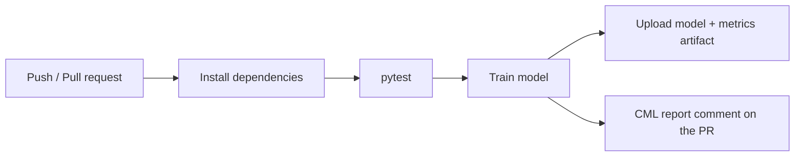

# ML CI/CD Pipeline with GitHub Actions and CML

A small MLOps project: every push and pull request triggers a GitHub Actions workflow that tests the code, trains a scikit-learn model, saves the model as a build artifact, and posts a metrics report with a plot as a comment on the pull request using [CML](https://cml.dev).

## Pipeline



## What it does

- **Tests:** checks that training runs, writes its artifacts, and reaches a minimum R²
- **Training:** linear regression on scikit-learn's diabetes dataset, with a fixed seed and an 80/20 split
- **Artifacts:** `model.joblib`, `metrics.json` and a predicted-vs-actual plot, downloadable from each workflow run
- **Reporting:** CML posts MAE, RMSE, R² and the plot on pull requests

## Run locally

```bash
git clone https://github.com/olive-s-11/ml-ci-cd-cml-pipeline.git
cd ml-ci-cd-cml-pipeline
pip install -r requirements.txt
python -m pytest
python train.py
```

## Possible extensions

- Track experiments with MLflow
- Version data and models with DVC
- Containerize training with Docker
